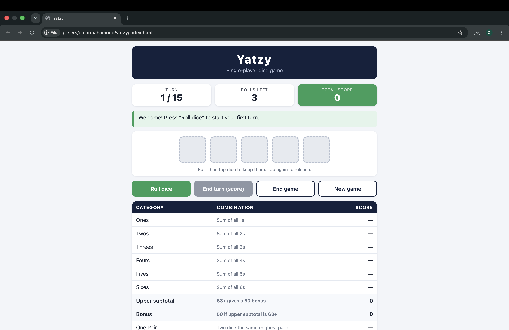
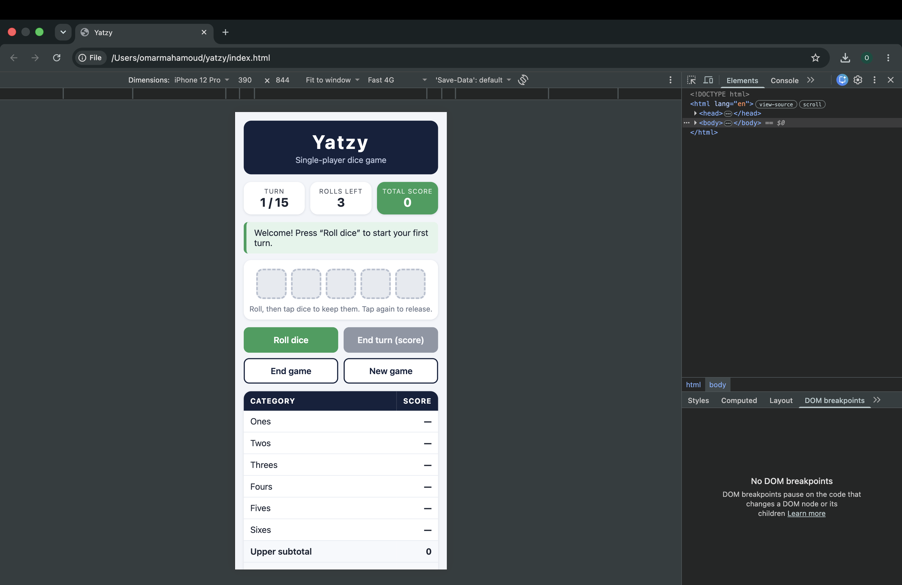

# Yatzy – Single-Player Dice Game

A web-based single-player Yatzy game built with HTML, CSS and JavaScript (no server, no libraries).
Course: CST3106 Internet Architecture and Web Development – Assignment 1.
Author: Omar Mahamoud

## How to run

1. Download or clone this repository.
2. Double-click `index.html` to open it in a browser (Chrome, Safari, Firefox).

No install and no server are needed. It also works on GitHub Pages.

## How to play

1. Press **Roll dice**. Five dice are rolled.
2. Tap a die to **keep** it (it turns green). Tap it again to release it.
3. Press **Roll again** to re-roll only the dice you did not keep. You get **3 rolls per turn**.
4. Tap a row on the scorecard to choose a category. The green numbers show what your dice would score there.
5. Press **End turn (score)** to lock the score in. The category is now used.
6. Repeat for **15 turns** (one per category). The game ends when all categories are filled.
7. You can also press **End game** at any time. Empty categories then count as 0.
8. Press **New game** to start over.

At the end you see your final score and a message: congratulations for 200 or more, otherwise an encouraging message.

## Scoring rules

| Category | Rule | Points |
|---|---|---|
| Ones – Sixes | Add up all dice showing that number | Sum of that number |
| One Pair | Two dice the same (highest pair counts) | Sum of the pair |
| Two Pairs | Two different pairs | Sum of the four dice |
| Three of a Kind | Three dice the same | Sum of the three dice |
| Four of a Kind | Four dice the same | Sum of the four dice |
| Small Straight | 1-2-3-4-5 | 15 |
| Large Straight | 2-3-4-5-6 | 20 |
| Full House | Three of one number + two of another | Sum of all five dice |
| Chance | Any dice | Sum of all five dice |
| Yatzy | Five dice the same | 50 |

**Upper bonus:** if Ones to Sixes add up to **63 or more**, you get **+50** points.
A category that does not match scores 0 (you must still pick a category each turn).

## Design elements

- **Theme:** navy (`#14213d`) and green (`#2e9e5b`) with a gold highlight for the selected row. Colours are CSS variables in `style.css`.
- **Status cards:** Turn (x / 15), Rolls left, and Total score are always visible at the top.
- **Message bar:** tells the player what to do next (for example "Keep the dice you want, then roll again").
- **Dice:** drawn with CSS only (a 3x3 grid of pips). Kept dice are green. Unrolled dice are grey and dashed.
- **Scorecard:** clickable rows. Possible scores are previewed in green, the selected row is gold, used rows are greyed out. Upper subtotal and bonus rows are shown after Sixes.
- **Buttons:** Roll dice, End turn (score), End game, New game. Buttons are disabled when they cannot be used.
- **Responsive:** one column layout. Buttons become a 4-in-a-row bar on screens 600px and wider. On phones (480px and below) the dice get smaller and the "Combination" column is hidden to save space.
- **Accessibility:** dice and rows can be used with the keyboard, dice have labels for screen readers, and focus outlines are visible.

## HTML / CSS mock-ups

Phone layout (wireframe):

```
+------------------------------+
|            YATZY             |
|     Single-player dice game  |
+------------------------------+
| TURN     ROLLS LEFT   TOTAL  |
| 3 / 15       2         41    |
+------------------------------+
| > Keep the dice you want...  |
+------------------------------+
|   [ ⚃ ] [ ⚂ ] [ ⚃ ] [ ⚅ ] [ ⚀ ] |
|  Roll, then tap dice to keep |
+------------------------------+
| [ Roll again ] [ End turn ]  |
| [ End game   ] [ New game ]  |
+------------------------------+
| CATEGORY              SCORE  |
| Ones                      3  |
| Twos                      —  |
| ...                          |
| Upper subtotal            3  |
| Bonus                     0  |
| One Pair                  8  |
| ...                          |
| Yatzy                     0  |
+------------------------------+
```

Desktop layout: same blocks, centred in a column up to 760px wide, the four buttons in one row and the scorecard showing the "Combination" column.

   Screenshots of the finished game:

   

   
## Project structure

```
index.html        page layout (status, dice, buttons, scorecard, final box)
style.css         theme, dice drawing, responsive rules
Dice.js           Dice class: roll, keep (hold), reset
YatzyEngine.js    YatzyEngine class: 15 scoring rules, score table, bonus, total
YatzyGame.js      YatzyGame class: turn flow, game state, updates the page
tests.js          automatic tests for the scoring rules (run with Node)
```

## Code organisation

- `Dice` only knows about dice values and which ones are kept.
- `YatzyEngine` only knows the rules and the score table (no page code).
- `YatzyGame` connects the two to the page, manages rolls left, turns, selection and the end of the game.

## Testing

**Automatic tests:** `node tests.js` runs 31 checks on the scoring rules and dice. Result: **31 passed, 0 failed**. They cover:

- Ones to Sixes, including 0 points when the number is missing
- One Pair picks the highest pair, Two Pairs needs two different pairs
- Three of a Kind and Four of a Kind (including the no-match cases)
- Small and Large Straight (and wrong straights scoring 0)
- Full House, and five of a kind does not count as a Full House
- Chance and Yatzy
- A category cannot be used twice, and wrong dice counts are rejected
- Upper bonus: 63 gives +50, less than 63 gives 0
- Kept dice never change when re-rolling

**Manual tests in the browser:**

- Cannot keep dice or score before the first roll
- Rolls left goes 3 → 2 → 1 → 0, Roll button disables at 0
- Kept dice stay the same on re-roll
- Used categories cannot be picked again
- Turn counter reaches 15 / 15, then the game ends with the final score
- End game button asks for confirmation and ends early
- New game resets scorecard, turn, rolls and total
- Layout checked at desktop width and at phone width (Chrome DevTools device mode)